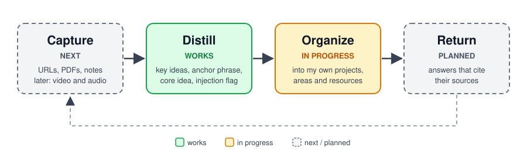
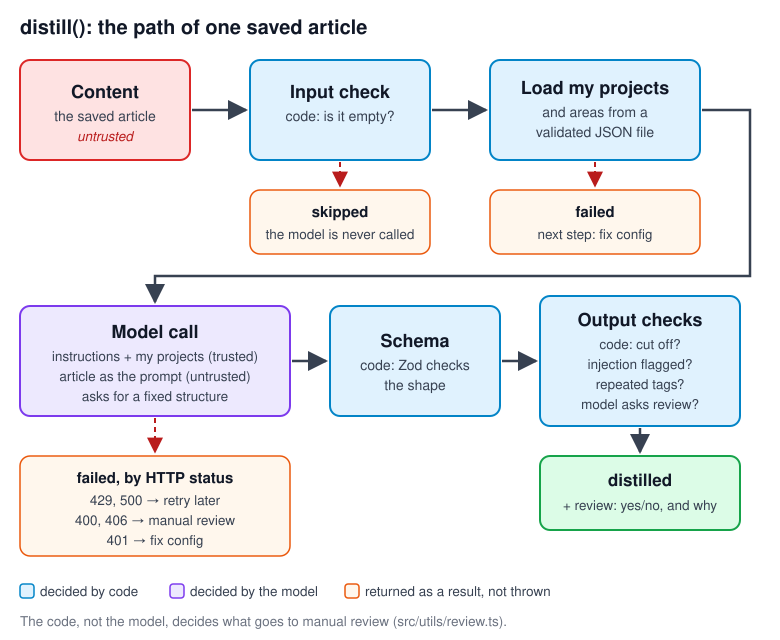

# Alembic

A personal knowledge agent built on one loop: **capture → distill → organize → return**.

I save articles, web pages, PDFs, videos and notes "for later", and they never come back. Alembic reads what I save, distills it into the ideas that matter, organizes it against my own projects and areas (PARA), and gives it back when I need it, citing where each answer comes from.

> **Work in progress, built in public.** I write every piece myself and post what works and what breaks along the way.



## Status

| Step | State |
|---|---|
| **Distill** | Works: the model returns a fixed structure (key ideas, anchor phrase, core idea, injection flag), validated with Zod |
| **Organize** | In progress: classifies into PARA (project, area, resource) using my declared projects and areas |
| **Capture** | Next: web pages (URLs), PDFs and notes. Later: video and audio, transcribed with Whisper and fed into the same loop |
| **Return** | Planned: answers with cited sources (RAG over pgvector) and evals in CI |

## How it works

One saved article goes through `distill()` (`src/index.ts`). Code checks the input before the model sees it and the output after; the model only reads and writes. Failures come back as a result with a next step instead of crashing the caller.



## Decisions so far

- **The provider is isolated.** Every model call in `src/` goes through `src/llm/provider.ts`, because the platform I first built on retired the agent I was using. Changing the model or the platform touches only that file. It does not mean the rest behaves the same: in my probes, tool calling and structured output changed from model to model, so a swap means rerunning them.
- **What the code can check, the model is never asked.** Empty input never reaches the model, and the code (not the model) decides what goes to manual review (`src/utils/review.ts`).
- **A fixed output structure guarantees shape, not truth.** The schema stops format drift, but the content is still checked in code.
- **My projects go in the instructions, not behind a tool.** With structured output and the tool left optional, the two models Alembic uses almost never called it: mimo-v2.6-flash 0/30, glm5.3-flash 2/30 (another model on the same platform, qwen3.8-flash: 30/30). Marking the tool as required fixed glm (30/30) but not mimo (0/30). So the declared list is passed as trusted context instead.
- **Chat Completions, not Responses.** The platform recommends `/chat/completions` and may retire `/responses`. Through Responses, the SDK assumed the server kept the conversation and a multi-step tool call failed; it also drops `seed`, which evals need to get a new sample on each repeat. Every call carries the full context.

## Stack

TypeScript · [Vercel AI SDK](https://ai-sdk.dev) · Zod · open models through an OpenAI-compatible API ([NaN](https://nan.builders)) · pgvector (planned)

## Run it

```bash
yarn install
cp .env.example .env                                    # add your API base URL and key
cp src/data/declared.example.json src/data/declared.json   # your own projects and areas
mkdir -p samples && echo "Any article text" > samples/article.txt
yarn start
```

Run it from the repo root: paths are resolved from the current directory.

## Layout

```
src/
  index.ts            distill(): input check → model call → review
  llm/provider.ts     the only place that knows the provider and models
  llm/prompts.ts      system instructions per role
  llm/schemas.ts      Zod schemas: the distillation output and the declared data
  llm/tools.ts        read-only tool (kept for later; not used in ingestion)
  data/declared.ts    loads, validates and filters declared projects and areas
  utils/review.ts     deterministic checks that decide manual review
```

## License

MIT
